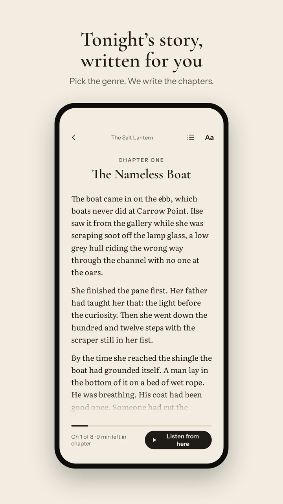
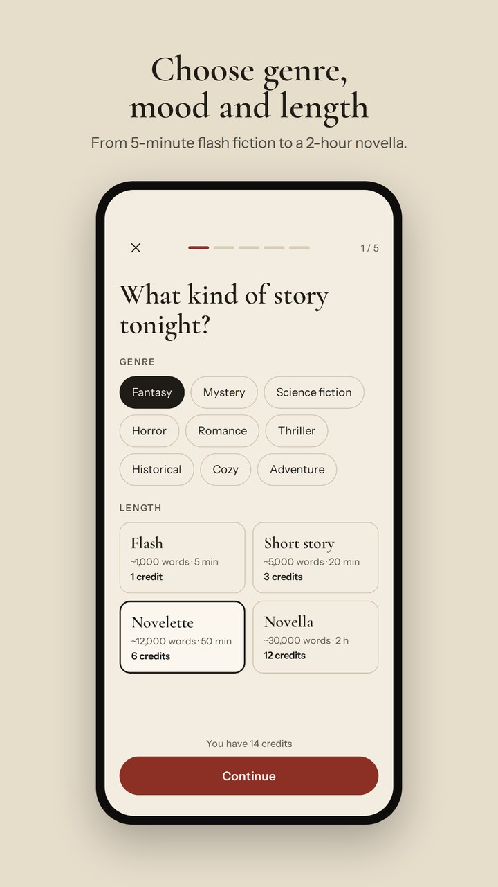
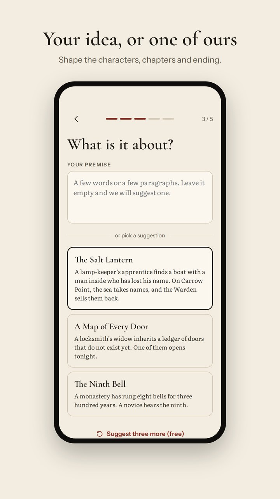
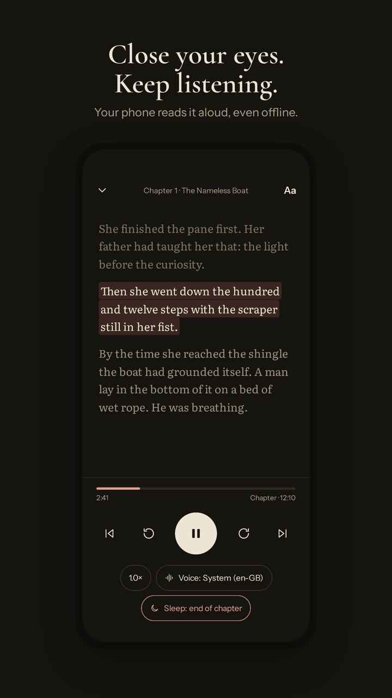
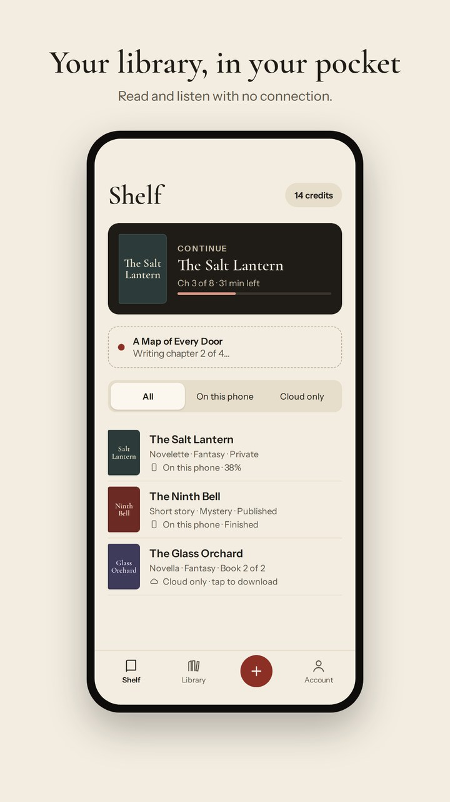
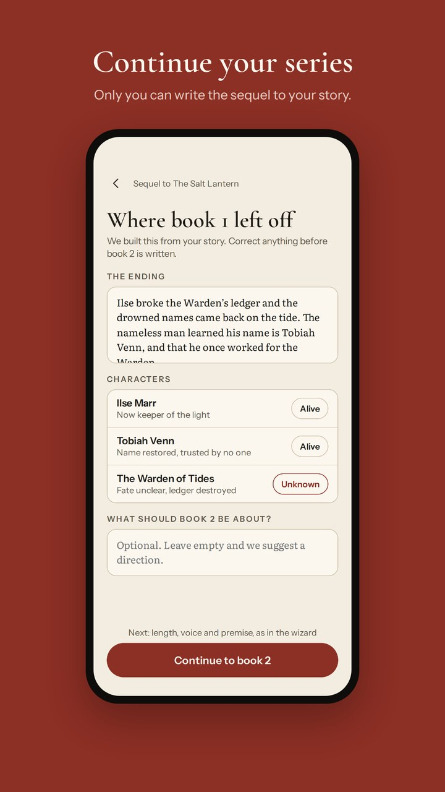
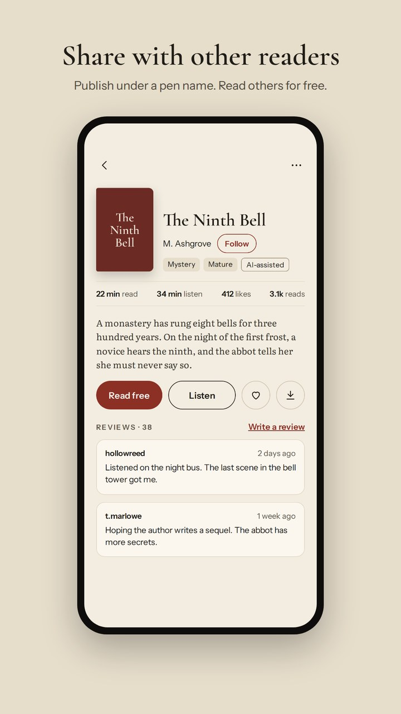

# Pocket Scriptorium

**Tonight's story, written for you.** Pocket Scriptorium is a mobile app that writes short fiction from the reader's choices, chapter by chapter. Read it on the page, or let the phone read it aloud with a natural voice that runs on the phone itself. Stories stay on the phone and work offline.

Website: [scriptorium.si](https://scriptorium.si/)



> Screenshots come from the store listing kit, built from the app's design with invented stories.

| Genre and length | Premise | Listen |
|---|---|---|
|  |  |  |

| Shelf | Sequel | Library |
|---|---|---|
|  |  |  |

## Features

- **Create.** Three forms: a finished story, an episodic series or an ongoing web novel. A six-step wizard: genre, subgenre, tropes and length; voice (tone, point of view, tense, content level, lead); premise (your own or three suggestions); refine (title, characters, chapters, ending); a cost estimate; then chapter 1. Saved templates and drafts.
- **Read.** Paper, Sepia and Night themes, three typefaces including Atkinson Hyperlegible, text size and spacing, scroll or pages.
- **Listen.** The phone's own voices or natural Kokoro voices that run on the phone, with sentence-by-sentence highlighting, lock-screen and headset controls, a sleep timer and background playback. No audio files are stored.
- **Keep.** Stories live on the phone, encrypted, for offline reading; progress syncs, and stories export as EPUB, PDF or TXT.
- **Continue.** Each story keeps a record of characters, places, the ending and open threads. The owner corrects it and writes a sequel or the next episode. A web novel grows in batches of six chapters, arc by arc.
- **Share.** Publish under a pen name to a public library after an automatic check, with likes, follows, reviews (after reading half), reports and blocks. Every public story is labelled "AI-generated".
- **Pay.** Credits per story, from one for flash fiction to twelve for a novella; credit packs through Google Play, no subscription. A story that cannot be finished refunds itself.

## How a story is written

Generation runs only on the server, as queue jobs; the app never talks to a model.

```
wizard choices ─► safety check ─► plan (title, cast, chapter beats, hidden solution) ─► hold credits
      ┌──────────────────────────────────────────────────────────────────────┘
      ▼
chapter n: draft ─► clean ─► deterministic checks ─► word and continuity reviews
      ─► up to two targeted revisions ─► safety check ─► ready (notification)
      ─► summary + story record ─► next chapter … ─► ending, blurb ─► capture credits
                                 any failure ─► refund
```

- **The model never judges its own work.** Deterministic checkers score every chapter for the habits of machine prose (negation pivots, rule of three, recap endings, choppy rhythm, echoes, name drift, genre habits, content ceilings, length). Two short reviews on a cheaper model look for odd word senses and contradictions, and only the flagged passages are revised. The method comes from Scriptorium, the in-house writing desk.
- **Consistency by design.** Mysteries, thrillers, science fiction, horror and fantasy plans keep a hidden solution; each chapter gets the genre template, the characters with their personality axes, the story record and summaries of the earlier chapters.
- **Models per tier** are mapped in the database and reached through a model gateway with streaming, time limits, retries and a fallback model. Every call is logged with tokens and cost. No user email or ID is ever sent to a model provider.

## Tech stack

Laravel 13 · PHP 8.5 · PostgreSQL · Redis · Horizon · Filament · Sanctum · Pest (1,500+ tests) · Vue 3 · TypeScript · Pinia · Capacitor 8 · ONNX Runtime (Kokoro on the phone) · RevenueCat · OpenRouter

## Design principles

- **Credits are an append-only ledger.** Hold, then capture or release; a failed story always refunds.
- **Only the owner continues a story.** Sequels are enforced by a policy, not by the interface.
- **Reviews need evidence.** A review is possible only after half the story was read, checked on the server.
- **Privacy toward model providers.** No user identity leaves the server with a prompt.
- **Readable everywhere.** Design tokens only, touch targets of at least 44 px, no default component look.

## Availability

Pre-release on Android; iOS follows after the launch.

Copyright (c) 2026 MUNDA PLUS d.o.o. All rights reserved. See [LICENSE](LICENSE).

Licensing enquiries: https://www.munda.si/#contact
